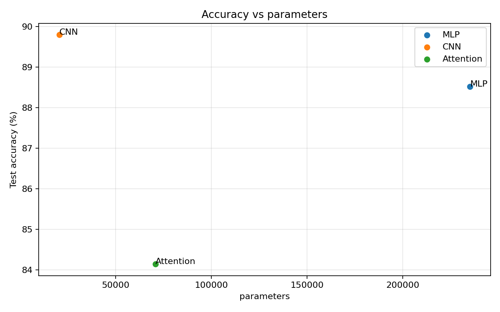
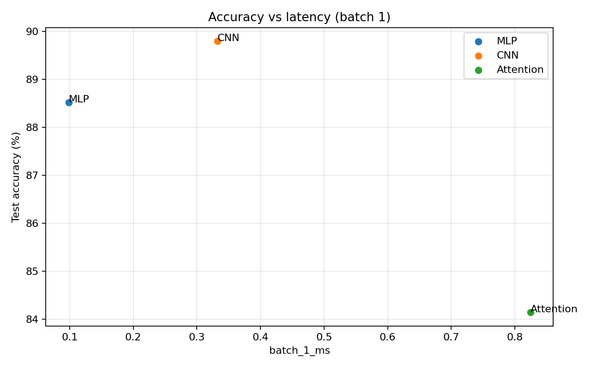
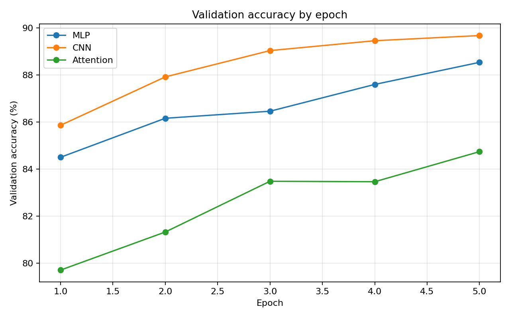

# Lab 3: Architectures and their costs

## 1. Objective
Compare MLP, CNN and patch-based Transformer architectures on FashionMNIST using accuracy, parameter count, computational cost and inference latency.

## 2. Dataset and setup
- FashionMNIST: 55,000 training, 5,000 validation and 10,000 official test images.
- Image size: 28x28 grayscale.
- Transform: ToTensor and Normalize((0.2860,), (0.3530,)).
- Random seed: 42.
- Batch size: 128; 5 epochs.
- Optimizer: Adam, learning rate 0.001.
- Loss: CrossEntropyLoss.
- Runtime: CPU, PyTorch 2.15.0+cpu.

## 3. Architectures
**MLP:** Flatten 784 inputs; Linear(784,256), ReLU, Linear(256,128), ReLU, Linear(128,10).

**CNN:** Conv2d(1,16,3,padding=1), ReLU, MaxPool2d(2), Conv2d(16,32,3,padding=1), ReLU, MaxPool2d(2), Flatten, Linear(1568,10).

**Attention:** Sixteen non-overlapping 7x7 image patches; projection 49 to 64 dimensions; two Transformer encoder layers with 4 heads and feed-forward dimension 128; mean pooling and Linear(64,10).

## 4. Experimental results

| Model | Parameters | Hand FLOPs/image | THOP MACs/image | Test accuracy | Batch 1 (ms) | Batch 128 (ms) |
|---|---|---|---|---|---|---|
| MLP | 235,146 | 469,504 | 234,752.0000 | 88.52% | 0.0988 | 0.3622 |
| CNN | 20,490 | 2,063,488 | 1,031,744.0000 | 89.80% | 0.3325 | 8.9261 |
| Attention | 70,794 | 2,329,856 | 591,488.0000 | 84.14% | 0.8242 | 3.3076 |

### Validation accuracy by epoch

| Epoch | MLP | CNN | Attention |
|---|---|---|---|
| 1 | 84.50% | 85.86% | 79.70% |
| 2 | 86.16% | 87.92% | 81.32% |
| 3 | 86.46% | 89.04% | 83.48% |
| 4 | 87.60% | 89.46% | 83.46% |
| 5 | 88.54% | 89.68% | 84.74% |

### Comparison plots

## 5. Parameter and FLOP methodology
Trainable parameters were counted from model parameters and inspected with torchinfo.

One multiply-accumulate operation is counted as two FLOPs. Dense-layer FLOPs use 2 x input features x output features. Convolution FLOPs use 2 x kernel height x kernel width x input channels x output channels x output height x output width.

The attention estimate includes patch projection, Q/K/V projections, output projection, attention score and weighted-value products, feed-forward layers and classifier. Biases, normalization, activation, softmax, residual operations and pooling are excluded.

THOP reports MACs for operations it recognizes. Multiplying MACs by two gives an approximate FLOP count. Its attention coverage may be incomplete, so the estimates are not expected to match exactly.

## 6. Architectural and system-level trade-offs

- **MLP:** Dense layers mix all input positions, but flattening removes explicit spatial structure. Dense matrix operations have regular access patterns.
- **CNN:** Local filters share weights across spatial positions and exploit image locality. Pooling reduces feature-map dimensions and later computation. Convolution performance benefits from data reuse and efficient memory layouts.
- **Attention:** Converts image patches into tokens. Each token can interact with every other token, allowing global relationships. Attention score computation grows quadratically with sequence length.
- **System-level effects:** FLOPs and parameter count do not fully determine latency. Memory traffic, cache behavior, tensor layout, batch size and CPU implementation also affect runtime. Batch 1 represents single-input latency, while batch 128 measures a different workload.

## 7. Interpretation
The best measured test accuracy was **CNN (89.80%)**.

The fastest batch-1 model was **MLP (0.099 ms median)**.

The smallest model was **CNN (20,490 parameters)**.

The CNN achieved the highest accuracy in this experiment while using substantially fewer parameters than the MLP. The Transformer did not reach the same accuracy after five epochs. These results are specific to this dataset split, training configuration and CPU environment.

The assignment's suggested 100k–150k parameter range conflicts with the explicitly specified architectures: the MLP alone has 235,146 parameters. The prescribed layer definitions were followed rather than changing the architecture.

## 8. Reproducibility and output files
The random seed was 42. Training history and model comparisons are saved as CSV files. Model checkpoints, plots and torchinfo summaries are also saved in the project folders.

Latency was measured using 10 warm-up forward passes, followed by 100 measurements for batch size 1 and 20 measurements for batch size 128. Reported latency is the median wall-clock time in milliseconds. Results depend on the hardware and software environment.
